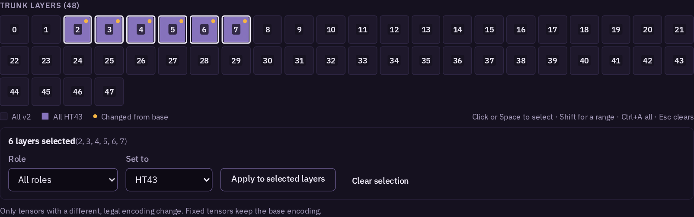
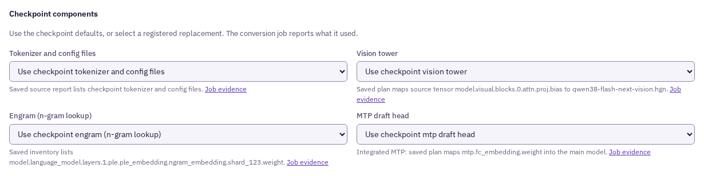

# Model Brewery

Model Brewery is a Linux workbench for inspecting, editing, converting and evaluating model checkpoints. A Rust controller serves the web interface and keeps a shared model library and durable job queue. Workers can run locally or on explicitly configured SSH hosts.

**Start here:** [Install Model Brewery](INSTALL.md). The guide sets up a loopback user service, installs the three agent skills, and tells the installing agent to ask before adding extra worker hosts. You can start the controller without a GPU or a worker.

## What you can do

- Download a pinned checkpoint and inspect its tensor inventory.
- Edit individual weights in supported formats, review the changes, and publish a separate revision without replacing the source.
- Convert supported models to HGN or GGUF through inspect, plan, convert, and independent verification. Available conversions depend on the source architecture and worker runtime.
- Trace models, run benchmarks, and score GSM8K with or without a diagnostic reference.

## Inside the workbench

**Edit a weight.** Select a tensor, then choose a cell in its heatmap to inspect the stored value and propose a change.

**Review before applying.** In this example, the original weight is `0.125`. The requested `0.1` rounds to `0.0999755859375` in F16. Applying the proposal creates a separate revision and keeps the original checkpoint.

**Set a quantization profile.** In this example, layers 2 through 7 use HT43 for eligible tensors; the other layers keep the base profile.

**Choose checkpoint components.** Keep the embedded components or select replacements from the model library.

## Reference

- [Operator guide](OPERATOR.md): worker setup, supported formats, job rules, Settings and troubleshooting.
- [API contract](api/openapi.json) and [command-line client](tools/brewery-agent).
- [Project skills](.opencode/skills/): workbench operation, calibration and benchmarking, and release qualification.
