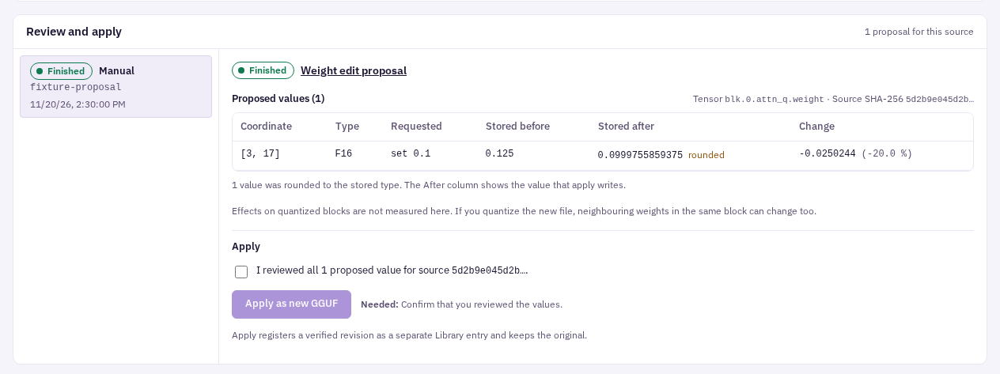

# Model Brewery

Model Brewery is a Linux workbench for inspecting, editing, converting and evaluating model checkpoints. A Rust controller serves the web interface and keeps a shared model library and durable job queue. Workers can run locally or on explicitly configured SSH hosts.

Model Brewery is a work in progress. [Issues](https://github.com/Quat3rnion/model-brewery/issues) and [pull requests](https://github.com/Quat3rnion/model-brewery/pulls) are welcome.

**Start here:** [Install Model Brewery](INSTALL.md). The guide sets up a loopback user service, installs the agent skills, and tells the installing agent to ask before adding extra worker hosts. You can start the controller without a GPU or a worker.

## What you can do

- Download a pinned checkpoint and inspect its tensor inventory.
- Edit individual weights in supported formats, review the changes, and publish a separate revision without replacing the source.
- Convert supported models to HGN or GGUF through inspect, plan, convert, and independent verification. Available conversions depend on the source architecture and worker runtime.
- Trace models, run benchmarks, and score GSM8K with or without a diagnostic reference.
- Program model weights with AI agents through an MCP server, or with the built-in workbench agent. See [Weight-space programming](#weight-space-programming).

## Weight-space programming

Agents and operators can read, change and test model weights. All changes go to scratch revisions. A scratch revision is a private child copy of a SafeTensors model with a reversible delta and a provenance record. The source model does not change. Only an operator can approve a scratch revision for the Library, in the workbench. Results are not release-qualified.

- **Trace.** Capture activations, attention, model logits and a logit lens per layer for one GGUF model or scratch revision. Each trace job has a byte limit and a retention limit. The worker runs a pinned, headless [Lanternfish](https://github.com/Quat3rnion/lanternfish) CLI on the CPU. See [CPU trace jobs](OPERATOR.md#cpu-trace-jobs).
- **Measure behavior directions.** Fit per-layer directions for slop, sycophancy, and response length on a Qwen2 GGUF. Read held-out separation scores and versioned vectors without changing weights. See [Behavior directions](OPERATOR.md#behavior-directions).
- **Steer and patch.** Add, replace, scale or remove activations during a trace, or copy activations from an earlier trace. Save interventions as versioned Library artifacts, and export steering vectors as llama.cpp control vectors. See [Trace interventions](OPERATOR.md#trace-interventions).
- **Edit weights.** Set or add values in a tensor slice, apply a rank-one update, or orthogonalize a weight against a direction. See [Scratch weight revisions](OPERATOR.md#scratch-weight-revisions).
- **Edit facts.** Use ROME, MEMIT or AlphaEdit on dense Llama and Qwen2 models, on the CPU or with a pinned CUDA or ROCm runtime. See [Locate and edit a fact](OPERATOR.md#locate-and-edit-a-fact).
- **Merge models.** Use linear averages, task arithmetic, TIES, DARE-linear or DARE-TIES. See [Merge revisions](OPERATOR.md#merge-revisions).
- **Prune.** Set weights to zero by magnitude, by MLP neuron, by attention head, or with a Wanda score. Plan REAP expert pruning for MoE models. Applying an expert plan to a scratch revision is not available yet.
- **Use SAE features.** Train a TopK sparse autoencoder on the CPU or import a public one, read feature activations in a trace, and steer one feature. See [Sparse autoencoders](OPERATOR.md#sparse-autoencoders-saes).
- **Compile programs.** Compile RASP programs with Tracr or ALTA into small standalone models, and check their outputs. See [Compiled programs](OPERATOR.md#compiled-programs).
- **Check and compare.** Before an agent can request publication, the worker checks tensor integrity, loads and runs the model, and measures target, paraphrase, locality and perplexity scores. Optional [behavior direction checks](OPERATOR.md#behavior-direction-checks) score held-out chat replies and measure KL divergence from the parent. Compare two revisions by tensors, by traces or by behavior. See [Checks before a publish request](OPERATOR.md#checks-before-a-publish-request) and [Compare revisions and traces](OPERATOR.md#compare-revisions-and-traces).

**MCP for agents.** The controller serves an MCP endpoint (Streamable HTTP) at `/mcp` on the workbench address. It gives agents tools to list and register models, trace, steer, edit, merge, prune, check, compare and request publication. MCP has no approve tool. MCP uses the same access checks as the workbench and has no separate token. See [MCP for weight-space work](OPERATOR.md#mcp-for-weight-space-work) for the client configuration and the access risk.

**Built-in agent.** The **Agent** page runs an agent in the workbench with the same tools as MCP. Set an Anthropic or OpenAI-compatible provider and its API key in Settings. The key is write-only. See [Hosted workbench agent](OPERATOR.md#hosted-workbench-agent).

**Workbench views.** **Trace** shows layer-by-token heatmaps, the logit lens and attention. **Edits** shows the scratch revisions of each source model, their checks and diffs, and the approval action for the operator.

Stage acceptance results on Qwen2.5-0.5B-Instruct: [Stage 1](qualification/weight_space_acceptance.md), [ROME, MEMIT and AlphaEdit](qualification/weight_space_stage2.md), [merges](qualification/weight_space_merge_acceptance.md), [SAE features](qualification/weight_space_sae.md) and the [CUDA edit runtime](qualification/lanternfish-w14b-cuda.md).

## Inside the workbench

**Edit a weight.** Select a tensor, then choose a cell in its heatmap to inspect the stored value and propose a change.

**Review before applying.** In this example, the original weight is `0.125`. The requested `0.1` rounds to `0.0999755859375` in F16. Applying the proposal creates a separate revision and keeps the original checkpoint.

**Set a quantization profile.** In this example, layers 2 through 7 use HT43 for eligible tensors; the other layers keep the base profile.

For ROCmFPX formats and worker requirements, see [ROCmFPX GGUF qualification](qualification/rocmfpx.md).

**Choose checkpoint components.** Keep the embedded components or select replacements from the model library.

## Reference

- [Operator guide](OPERATOR.md): worker setup, supported formats, job rules, Settings and troubleshooting.
- [Design guide](DESIGN.md): current web interface tokens, layout, interaction and accessibility patterns for contributors.
- [API contract](api/openapi.json), [command-line client](tools/brewery-agent) and [MCP endpoint](OPERATOR.md#mcp-for-weight-space-work).
- [Project skills](.opencode/skills/): workbench operation, weight-space work through MCP ([`brewery-weight-space`](.opencode/skills/brewery-weight-space/SKILL.md)), calibration and benchmarking, and release qualification.
